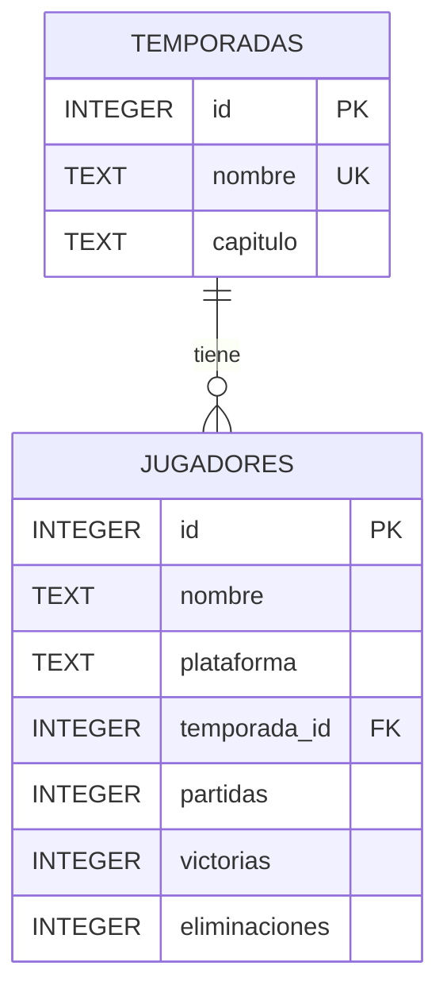

# Diagrama entidad-relación — Fortnite Tracker

## Tablas y relaciones

- **temporadas**: catálogo de temporadas; `id` es la llave primaria. `nombre` es único y `capitulo` identifica el capítulo.
- **jugadores**: registros de estadísticas; `id` es la llave primaria, `temporada_id` es llave foránea hacia `temporadas.id`.
- **Relación 1:N**: una temporada puede tener muchos jugadores y cada registro de jugador pertenece a una temporada.
- No se puede eliminar una temporada si hay jugadores asociados (`ON DELETE RESTRICT`).
- `victorias` no puede ser mayor que `partidas`; los contadores no pueden ser negativos.

*Nota: las temporadas y estadísticas del ejemplo son datos inventados con fines educativos, no información de Fortnite en tiempo real.*
